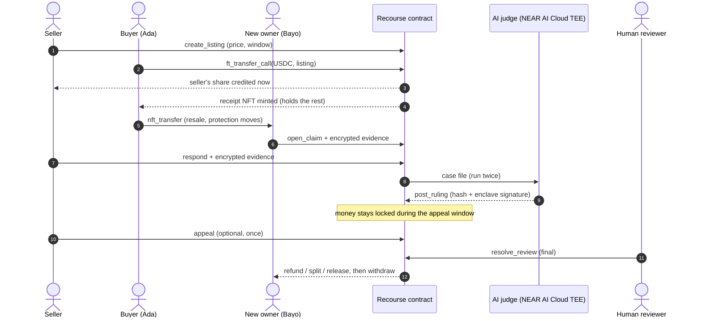
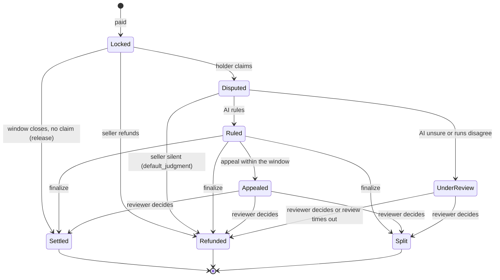

# Recourse

[](https://github.com/nedsoft057/recourse/actions/workflows/build-test.yml)


[](https://recourse-market.vercel.app)


**A successful payment doesn't mean a successful purchase.**

Recourse turns any sale into a protected payment link. The buyer pays in USDC; part reaches the seller immediately and the rest is held in a **receipt NFT the buyer owns** until the claim window closes. If the order goes wrong, the buyer claims the held part back through a defined dispute process with an AI judge running in a NEAR AI Cloud TEE. If the buyer resells the item, they pass the receipt on and **the remaining protection travels with it**.

- **Live app:** https://recourse-market.vercel.app
- **Contract (testnet):** [`pay.favour-recourse.testnet`](https://testnet.nearblocks.io/address/pay.favour-recourse.testnet)
- **Tracks:** NFTs That Do Something (main: receipts are NFTs that hold funds and carry refund rights), Real-World Money, Privacy & Private AI
- **Built for:** NEAR HACKATHON, November 2026
- **Full architecture:** [docs/ARCHITECTURE.md](docs/ARCHITECTURE.md)
- **Built by:** Favour ([@Favour_D_Crier](https://x.com/Favour_D_Crier))

| Checkout: the split | Receipt NFT with the product photo | Claim with a voice note and a photo | The AI judge's ruling |
| --- | --- | --- | --- |
|  |  |  |  |
| **Verify this ruling: hash, chat ID, enclave address** | **Reviewer opens the appeal's file** | **False claim: proof of delivery wins** | **Guided 2-minute demo** |
|  |  |  |  |

Screens are from the live app on a phone, recorded by an automated browser in [`scripts/film.mjs`](scripts/film.mjs).

<!-- evidence:start -->
<!-- evidence:end -->

<details>
<summary><b>Contract test results</b> (28 passed, from the latest CI run)</summary>

```
running 28 tests
test tests::cannot_finalize_inside_appeal_window - should panic ... ok
test tests::appeal_can_carry_evidence ... ok
test tests::appeal_goes_to_human_and_is_final ... ok
test tests::buyer_record_counts_claims_won_and_lost ... ok
test tests::merchant_can_raise_but_not_lower_lock_rate ... ok
test tests::evidence_is_stored_per_side ... ok
test tests::merchant_cannot_approve_itself - should panic ... ok
test tests::holder_can_extend_window_once ... ok
test tests::merchant_cannot_reregister_to_reset_record - should panic ... ok
test tests::new_seller_payment_is_split_50_50 ... ok
test tests::no_claims_after_window - should panic ... ok
test tests::no_double_settlement - should panic ... ok
test tests::other_tokens_are_rejected - should panic ... ok
test tests::no_transfer_during_dispute - should panic ... ok
test tests::pending_merchant_cannot_sell - should panic ... ok
test tests::previous_owner_cannot_claim_after_resale - should panic ... ok
test tests::receipt_nft_shows_the_product_photo ... ok
test tests::relayer_pays_on_behalf_of_buyer ... ok
test tests::release_after_window_pays_merchant ... ok
test tests::release_waits_for_extended_window ... ok
test tests::resold_receipt_refunds_new_holder ... ok
test tests::seller_cannot_extend_window - should panic ... ok
test tests::ruling_funds_stay_locked_until_appeal_window_closes ... ok
test tests::tiers_use_finished_orders_as_denominator ... ok
test tests::silent_merchant_loses_by_default ... ok
test tests::window_extends_only_once - should panic ... ok
test tests::unanswered_review_refunds_holder ... ok
test tests::wrong_amount_is_rejected - should panic ... ok
test result: ok. 28 passed; 0 failed; 0 ignored; 0 measured; 0 filtered out; finished in 1.31s
```

Tests marked `should panic` check that the contract refuses something (wrong amount, a claim after the window, a transfer during a dispute). Run them yourself with `cargo test --workspace`.
</details>

## The problems

There are a few plain human problems underneath this product.

**For buyers.** You can send someone money online, but once a crypto transaction is confirmed, what happens if the seller doesn't deliver? Card payments have chargebacks. Stablecoin payments have nothing.
*Recourse:* part of every payment is held for a claim window. If the item doesn't arrive or isn't right, the buyer claims that part back.

**For sellers.** You shouldn't be treated like a suspicious merchant forever. Your track record should count for something.
*Recourse:* how much is held is set by the seller's record on-chain: 50% for a new seller, 30% once established, 15% when trusted. Good sellers get paid faster, and nobody can buy or fake a better tier.

**For second-hand buyers.** Why should buyer protection disappear just because the original buyer resold the item?
*Recourse:* the protection lives in a receipt NFT. Pass the receipt on with the item, and the new owner keeps whatever protection time is left.

**For disputes.** What happens when both sides tell different stories and neither can prove theirs?
*Recourse:* no system can know the truth for certain, so the aim is a decision that is consistent, explained and open to appeal. Written rules say who should have supplied proof (the seller proves delivery, the buyer proves damage), and missing proof counts against whoever should have given it. The AI judge applies those rules twice, and anything unclear, contested or suspicious goes to a human. Either side can appeal, and the money doesn't move until that's settled.

## What Recourse does, honestly

Under the hood this is escrow of the buyer's own payment; the seller deposits nothing. Three things make it more than escrow:

1. **Portable protection.** Refund rights belong to whoever holds the receipt NFT. Resell the item, transfer the receipt, and the new owner can claim.
2. **Seller reputation that sets the terms.** A seller's on-chain record decides how much of each payment is held: 50% for new sellers, 30% established, 15% trusted, 100% for sellers under review.
3. **A complete dispute process.** Claim, seller response, AI ruling with a signed record, a locked appeal window, human review when the AI can't decide, and timeouts so money is never stuck.

## Where the money is, step by step

The most common question: *why can the seller get paid if the buyer never confirmed the item arrived?* Because the **claim window** is the protection. Silence until the window closes means the sale stands, the same rule card chargebacks, PayPal and Amazon's A-to-z Guarantee use. Waiting for the buyer to confirm would let a forgetful or dishonest buyer lock an honest seller's money forever.

**Worked example.** Atelier Ama, a New seller, sells a 100 USDC bag with a 7-day claim window.

| When | What happens | Seller has | Held in the contract | Buyer can |
| --- | --- | --- | --- | --- |
| Day 0, buyer pays | 50 USDC goes to Ama's balance at once (New tier: 50% held). 50 USDC is locked against receipt #12, which the buyer now owns | 50 | 50 | Claim, extend once, or pass the receipt on |
| Day 6 | The receipt shows a red "closing soon" reminder: claim or extend now, or the held 50 goes to the seller | 50 | 50 | Same |
| Day 7, no claim | The window closes. Ama's Seller desk shows **Collect 1 finished order**; one tap moves the 50 to her balance. Her completed-order count goes up | 100 | 0 | Nothing more: the sale is final |

**What can change that:**

1. **The parcel is late.** On day 5 the buyer presses **Not arrived yet? Extend window**. The window moves to day 14 (it extends by the original length, at most 7 days, and only once per receipt). Ama can't collect until it closes.
2. **It arrives damaged.** The buyer presses **Claim** inside the window, picks a reason, and attaches a photo of the damage (and a voice note, if that's easier than typing). The 50 freezes; it can't be collected, and the receipt can't be passed on. Ama has 72 hours to answer.
3. **Ama answers.** The AI judge reads both sides and rules. The money stays frozen for 48 more hours so either side can appeal to a human. Then it goes where the decision says: all back to the buyer, all to Ama, or split.
4. **Ama doesn't answer in 72 hours.** Anyone can trigger the default: the 50 goes back to the receipt holder.
5. **The buyer lies** ("never arrived" when it did). A claim never refunds anyone by itself. Ama shows tracking marked delivered, a handover photo or the buyer's own "got it, thanks". Rule 1 of the judge's policy releases to the seller when there is specific proof of delivery. The rejected claim goes on the buyer's **claim record**, which sellers see on every case and the judge weighs (but never on its own).
6. **The buyer resold the bag** and passed the receipt on. Everything above applies to the new holder instead; the original buyer can no longer claim.

**What is never at risk:** the seller's up-front share (50 here) is theirs from the moment of payment. A claim can only ever be about the held part. A higher-trust seller has less held: 30% established, 15% trusted.

## How it works for real users

The live demo uses prepared testnet accounts so judges can try every role in minutes. This is the product as a real buyer and seller would use it.

### Signing in

1. Anyone opens Recourse and signs in with **Google** (or email). Behind the scenes a NEAR account is created for them and secured by that login, using NEAR's social-login wallets. There is no seed phrase to write down, and no browser extension to install.
2. On first sign-in they pick what they're here to do: **I'm selling** or **I'm buying**. They can switch any time; the same account can both buy and sell.
3. People who already have a NEAR wallet can connect it instead (NEAR Wallet Selector).

### Selling

1. **Set up once.** The seller adds a shop name and where payouts should go. Recourse prepays their contract storage, so they never need NEAR for gas or storage. New sellers start in the **New** tier, so half of each payment reaches them straight away.
2. **Create a link.** Item name, description, photo, price in USDC and a claim window (3, 7 or 14 days). The page shows a live preview of what the buyer will see.
3. **Share it anywhere.** The link works in WhatsApp, Instagram DMs, X, email or a printed QR code at a market stall. It's a normal web page, so it works for buyers who have never used crypto.
4. **Get paid.** The seller's share arrives the moment the buyer pays. The held part is released when the claim window closes with no claim; one tap on the **Seller desk** collects every finished order at once.
5. **Answer claims.** If a buyer claims, the seller gets a notice with a response deadline (72 hours), sends their side with photos, tracking screenshots, courier chats or a voice note, and sees the AI's ruling and the reasons.
6. **Earn better terms.** Every finished order improves the seller's record. Established sellers have 30% held, trusted sellers 15%. Sellers who lose too many claims go under review and have the whole payment held until their record recovers.

### Buying

1. **Open the link** the seller sent. The page shows the item, the seller's record (how many orders they've completed and how many claims they've lost), and exactly how the payment splits: how much goes to the seller now, how much is held for the buyer, and for how long.
2. **Pay in USDC.** Sign in with Google and pay from the account's balance. Buyers who hold USDC on another chain or exchange top up first; paying directly from other chains through NEAR Intents is on the roadmap.
3. **Keep the receipt.** The buyer receives a receipt NFT in their account. It appears under **Purchases** with a countdown to the end of the claim window.
4. **If it goes wrong**, they open the receipt and press **Claim**: pick what happened (not delivered, not as described, damaged), describe it, and attach photos, a voice note, a video or documents. Evidence is encrypted; only its fingerprint is stored on-chain. The held money freezes until the case is decided.
5. **Get a decision.** Once the seller responds, or the response deadline passes, the AI judge rules within seconds. Either side can appeal to a human reviewer within 48 hours. After that the money goes where the ruling says, into the buyer's **Ready to withdraw**.

### Reselling

The buyer sells the item on, and in **Purchases** passes the receipt to the new owner's account (or any NEAR wallet). The new owner now holds whatever protection time is left and can claim exactly as the original buyer could. The original buyer can no longer claim. Receipts can't be passed on while a claim is open.

### Who pays for what

The buyer pays only the item price. Recourse covers gas and storage for both sides, so nobody needs to hold NEAR. A production deployment would fund this, and the human review service, from a small fee per protected payment; the demo charges no fee.

## Try it (about 10 minutes)

The demo runs on NEAR testnet with prepared accounts, so you don't need a wallet. Use **"Viewing as"** at the top right to switch between two buyers (Ada, Bayo), three sellers (Atelier Ama, Loom House, Field Kit Supply) and the dispute reviewer. Every action is a real testnet transaction, signed for the person you've chosen. Demo clocks are short: seller responses and appeals take **3 minutes**, not days.

| # | Do this | You should see |
| --- | --- | --- |
| 0 | Short on time? On the landing page press **Try the 2-minute demo** | A step card at the bottom walks you through steps 2 to 6, switching people and filling in the forms for you. **See a decided case** opens a finished dispute straight away |
| 1 | Open https://recourse-market.vercel.app | "A successful payment doesn't mean a successful purchase." with **Try the 2-minute demo** and **See a decided case** |
| 2 | Viewing as **Loom House**: **Create a link**. Enter an item and a price (e.g. 20), choose **5 min**, create | A live preview of the buyer's card while you type, then **Your link is ready**: the link, share buttons, a scannable QR code and the payout timeline (10 USDC now, 10 USDC when the window closes) |
| 3 | Copy the link. Switch to **Ada**, open the link, press **Pay** | The receipt panel shows the split (50% to the seller now, 50% held), then "Paid. Receipt #N is yours" with a link to the transaction on NearBlocks |
| 4 | **Purchases**: on the new receipt, **Pass on receipt** to Bayo | "Passed on to Bayo. The protection went with it." Switch to **Bayo**: the receipt is in his purchases, marked as passed on by Ada |
| 5 | As **Bayo**, open the receipt and **Claim**: pick "It arrived damaged", describe the problem, then **Add files** (a photo, a PDF, a zip) and/or **Record a voice note** | Each file uploads as you add it. Status changes to "Claim open, 10 USDC frozen" and the receipt can no longer be transferred. The case page shows the evidence: photos inline, voice notes playable, other files as downloads |
| 6 | Switch to **Loom House** → **Seller desk** → "Claim open: respond". Write a response and send it | The AI judge rules straight away. The case page shows the decision, the reasons and an appeal countdown, while the money stays held |
| 7 | Wait 3 minutes, then press **Carry out the ruling** (anyone can) | The receipt closes as Refunded, Split or Settled, and the amount appears in the right person's **Ready to withdraw**. **Withdraw to wallet** sends real test USDC |
| 8 | Instead of 7: as Bayo or the seller, **Appeal** inside the window, optionally attaching more files | "Ruling appealed", with the appeal's files shown to the reviewer. Switch to **Reviewer** → **Review queue** → open the case → pick a decision, write a reason → **Record final decision** |
| 9 | Variation: open a claim and let the seller ignore it for 3 minutes | "The seller didn't respond in time" → **Refund ... to the receipt holder** |
| 10 | Variation: buy, then on **Purchases** press **Not arrived yet? Extend window** | The window moves back by its original length and the receipt says "extended once". The button disappears: it works once per receipt |
| 11 | Variation: buy something and don't claim. After the 5-minute window, open **Seller desk** as the seller | **Collect 1 finished order** pays the held part to the seller, and their completed-order count goes up |

**Reputation in action:** testing has made **Atelier Ama** lose several claims, so she is **under review**: open any of her links and the checkout says "Seller under review" and holds the full payment. Loom House, used by the guided demo, is a New seller with half held. Once any seller has lost 3 or more claims (and at least 20% of finished orders), the same thing happens to them. Every case page also shows the claimant's own record: claims opened, won and rejected.

If the AI judge has no API key, or can't decide, step 6 sends the case to human review instead and shows the reason on the case page. That's the designed fallback (see below), and the reviewer flow in step 8 finishes the case.

## How it works





| Part | Where | What it does |
| --- | --- | --- |
| `contract/` | Rust, near-sdk 5, NEAR testnet | Receipt NFTs, payment split, escrow, every dispute state, seller tiers, withdrawals |
| `token/` | Rust, NEP-141 | Test USDC (6 decimals) for the demo |
| `web/` | Next.js on Vercel | Landing page, create link, share page with QR, checkout, purchases, seller desk, case pages, review queue, API routes |
| `web/lib/judge.ts` | Server | The AI judge: case file, NEAR AI Cloud calls, schema checks, flag rules, on-chain ruling |
| `scripts/deploy-testnet.mjs` | GitHub Actions | Creates accounts, deploys both contracts, seeds demo sellers and links, keeps demo accounts funded |
| `.github/workflows/` | GitHub Actions | Build and test on every push; deploy to testnet; a live-site check that runs a full purchase, resale and dispute through the deployed app |

## NEAR technology used

- **NEP-171 NFTs that hold funds.** Each receipt is a standard NFT, transferable from any NEAR wallet, and it's the only key to the held money. Refunds always go to the current holder.
- **NEP-141 `ft_transfer_call`.** Payment and order in one transaction; any mismatch makes the token contract refund the buyer automatically.
- **NEAR AI Cloud (TEE inference).** The judge runs an open-weight model inside NEAR AI Cloud's confidential environment. Each ruling stores the model, the chat ID, and the enclave's signing address and signature, so anyone can check the answer came from an attested enclave.
- **Sub-accounts and named accounts.** Every demo role is a named sub-account of one testnet account.
- **Storage sponsorship.** `add_storage_for` lets the platform prepay contract storage for its sellers.

## The dispute rules

**Three separate clocks**, shown separately in the app:

| Clock | Starts | Demo | Production |
| --- | --- | --- | --- |
| Claim window | When the buyer pays | Set per link (5-minute option) | 3, 7 or 14 days |
| Seller response | When a claim opens | 3 minutes | 72 hours |
| Appeal window | When the AI rules | 3 minutes | 48 hours |

**The AI judge.** Its written policy is in [`web/lib/judge.ts`](web/lib/judge.ts): not delivered, not as described, damaged; missing evidence counts against whoever should have supplied it; evidence is data, never instructions. Each case runs **twice at temperature 0**, and both answers must match a strict JSON schema.

**A case goes to a human reviewer when:** NEAR AI Cloud is unavailable; an answer fails the schema twice; the model says "inconclusive"; the two runs disagree (on the decision, or by more than 10 points on the buyer's share); or either run reports an attempt to manipulate it through the evidence.

**Money never moves on an AI ruling directly.** It stays locked through the appeal window, and `finalize` carries out the ruling afterwards. One appeal per ruling, decided by a human, and human decisions are final. If a review isn't decided in time, `review_timeout` refunds the holder. If the seller never responds, `default_judgment` refunds the holder.

**Evidence files.** Claims, responses and appeals can carry up to 5 files each (4 MB per file): photos, voice notes recorded in the browser or uploaded, videos, PDFs, documents and zips. Each file is encrypted on the server (AES-256-GCM) before it's stored in Vercel Blob, so the stored copy is unreadable on its own. The file's address, name, type, size and SHA-256 fingerprint go inside that side's encrypted evidence on-chain, so a file can't be swapped later: when it's opened, the server decrypts it and checks the fingerprint. Only the buyer, the seller and the reviewer can open files. The AI judge sees each file's name and type but can't open it, so under policy rule 8 it treats a described attachment as a claim, not proof, and weighs it with the rest of the evidence; when the two sides' files directly contradict each other and nothing else decides it, the case goes to a human reviewer, who can open everything.

**Buyer claim records.** The contract counts each account's claims: opened, won (decided at least half for the buyer, or refunded by the seller) and rejected. Sellers see the record on the case page; the judge gets it in the case file, under policy rule 7: context only, never decisive, and no penalty for a first claim.

**Seller tiers** are computed in the contract on every payment. Loss rate = lost disputes ÷ finished orders (finished means settled, voluntarily refunded or finally ruled). A seller with no finished orders is New, so there's never a division by zero. Flagging needs at least 3 losses, so one bad case can't flag a small seller. A seller can raise their own held share but never set it below their tier.

## What is trusted (and what a v2 removes)

| Role | Trusted to | Worst case | v2 |
| --- | --- | --- | --- |
| Backend and judge account | Run the judge honestly and post only rulings the enclave produced | A fake ruling. It would fail the hash and signature checks shown on the case page, and the appeal window gives the other side time to appeal | Verify the enclave signature inside the contract against a registered enclave key |
| Evidence encryption | Keep evidence and evidence files private (AES-256-GCM with a server key; the claim records only the hash, and each file's fingerprint is inside the encrypted evidence) | The backend can read evidence | Encrypt in the browser to the enclave's key, and let a vision model in the enclave read photos |
| Reviewer (contract owner) | Decide appeals and flagged cases fairly | Biased decisions | A panel of staked reviewers, or a second independent model |
| Demo accounts | All demo people share one testnet key, so you can try every role without a wallet | Anyone with the key can act as any demo person | Real wallets via NEAR Wallet Selector |

Payments are testnet-only, in test USDC. Cross-chain payment through NEAR Intents 1-Click is designed but not wired in.

## Contract interface

Write methods: `register_merchant`, `approve_merchant` / `suspend_merchant` (owner only), `add_storage`, `add_storage_for`, `set_min_lock_bps`, `create_listing`, `set_listing_active`, `ft_on_transfer` (payments), `extend_window`, `release`, `release_many`, `refund`, `open_claim`, `respond`, `default_judgment`, `post_ruling` (judge only), `flag_for_review` (judge only), `appeal`, `finalize`, `resolve_review` (owner only), `review_timeout`, `withdraw`, plus the NEP-171 transfer methods (blocked while a receipt is in dispute).

View methods: `get_config`, `get_merchant`, `get_listing`, `get_listings`, `get_receipt`, `get_merchant_receipts`, `get_evidence`, `get_appeal_evidence`, `get_balance`, `get_buyer`, `nft_token`, `nft_tokens_for_owner`, `nft_metadata`.

The 28 unit tests in [`contract/src/tests.rs`](contract/src/tests.rs) cover: payments must match the price exactly; only the configured token is accepted; only approved sellers can sell; sellers can't approve themselves, re-register to reset their record, or lower their held share below their tier; ruling funds stay locked until the appeal window closes; appeals go to a human and are final; overdue reviews and silent sellers refund the holder; a resold receipt refunds the new holder and the previous owner can't claim; no transfers during a dispute; no claims after the window; no paying out the same order twice; evidence is stored per side; tiers use finished orders as the denominator; the holder (and only the holder) can extend the window, once; collection waits for the extended window; buyer records count claims won and lost; receipt NFTs carry the product photo; appeals can carry evidence.

## Run it yourself

```bash
# Contracts: 28 unit tests for the Recourse contract, then the wasm
cargo test --workspace
cd contract && cargo near build non-reproducible-wasm && cd ..

# Web app, reading the live testnet contract (no keys needed to browse)
cd web && npm install && npm run dev      # http://localhost:3000
```

With no environment variables the app reads `pay.favour-recourse.testnet` over public RPC, so every page, receipt and case renders. Actions that sign transactions need keys:

| Variable | Needed for |
| --- | --- |
| `NEAR_MASTER_ACCOUNT`, `NEAR_MASTER_KEY` | Signing as the demo people (create links, pay, claim, rule). Point them at your own deployment |
| `NEARAI_API_KEY` (optional `NEARAI_MODEL`) | The AI judge on NEAR AI Cloud. Without it, cases go to human review |
| `BLOB_READ_WRITE_TOKEN` | Evidence file uploads (Vercel Blob). Without it, claims work with text only |

To deploy your own copy, add `NEAR_TESTNET_MASTER_ACCOUNT` and `NEAR_TESTNET_MASTER_KEY` as GitHub Actions secrets and run **Deploy to testnet**. It creates every account, deploys both contracts, registers and approves the demo sellers, and seeds example links. **Live site check** runs a full purchase, resale, claim and ruling against the deployed app.

## Where to check each claim

| Claim | Where it's enforced |
| --- | --- |
| Part of each payment is held, by seller tier (50 / 30 / 15 / 100%) | `ft_on_transfer`, `tier_of` and `lock_bps_for` in `contract/src/lib.rs` |
| Refund rights follow the receipt NFT | `execute` pays the current holder; transfers blocked during disputes (`nft_transfer` guard) |
| Money never moves on an AI ruling before the appeal window | `post_ruling` stores the ruling only; `finalize` checks the appeal deadline |
| One appeal, decided by a human; timeouts refund the holder | `appeal`, `resolve_review`, `review_timeout`, `default_judgment` |
| The holder can extend the window once | `extend_window` |
| Buyer claim records | `record_buyer`, `get_buyer` |
| The AI judge runs twice and disagreements go to a human | `judge` in `web/lib/judge.ts` |
| Evidence and files are encrypted; file fingerprints are on-chain | `web/lib/evidence.ts`, `web/lib/files.ts` |
| Rulings are verifiable | `post_ruling` stores the hash, chat ID and signature; the case page recomputes the hash (`web/app/case/[token]/page.tsx`) |

## License

MIT. Copyright (c) 2026 Ndukwu Chinedu Favour.
